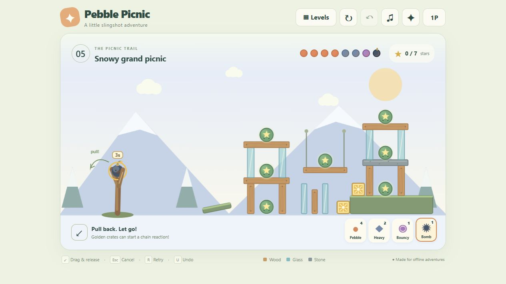
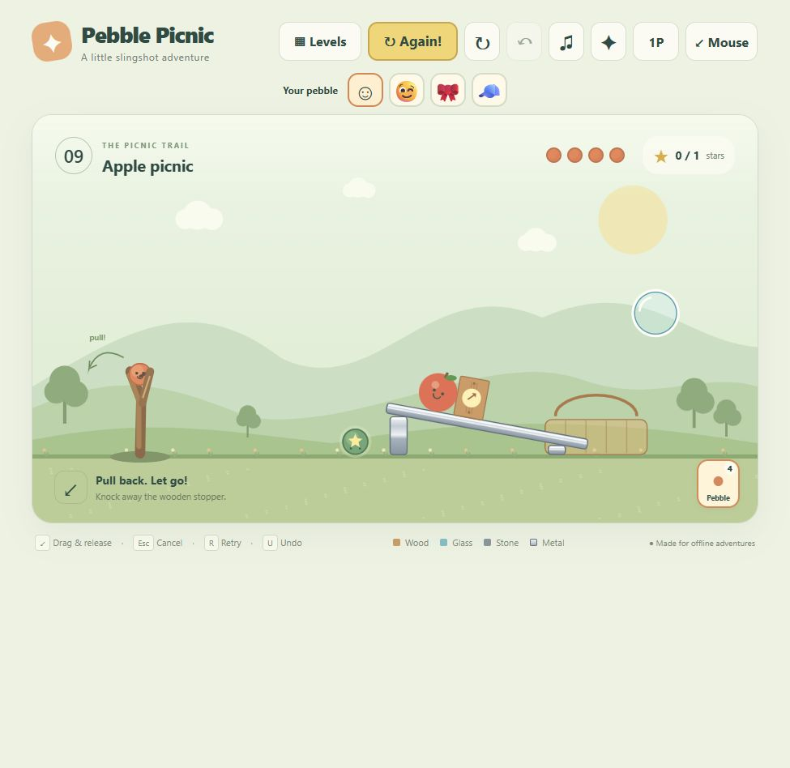
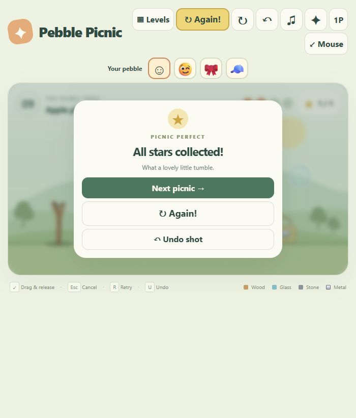

# Pebble Picnic

**A cheerful, fully offline slingshot game for children.** Pull back a pebble, topple playful structures and collect every green star pod—no installation, account or internet connection required.



Plain JavaScript · Canvas · Web Audio · Matter.js · [MIT licensed](LICENSE)

## Play

On Windows, download or clone the repository and **double-click `PLAY.cmd`**.

You can also open `index.html` directly in Chrome or Edge. Keep `index.html`, `styles.css`, `src/` and `vendor/` together when copying the game to another computer. There is no build step and nothing to install.

## What's inside

- **Ten handmade scenes:** five Adventure levels across gardens, a beach and snowy hills, plus five short Quick play scenes.
- **Playful physics:** tumble towers, ramps, dominoes, a seesaw, hanging bridges, rolling fruit and golden chain-reaction crates.
- **Four finite pebble types:** balanced, heavy, bouncy and a scarce timed bomb. Choosing a type never grants extra ammunition.
- **Friendly ways to play:** mouse controls, an Easy Mode for arrow keys and Space, unlimited retries and a one-shot Undo.
- **Solo or shared turns:** switch between one player and a local two-player team using the same mouse or keyboard.
- **Small surprises:** bubbles, flowers, funny faces, hats and hidden animals. Optional extras never decide whether you win.
- **Comfort controls:** mute and reduced-motion options, with preferences and earned stickers saved locally when the browser allows it.

<table>
  <tr>
    <td width="55%"></td>
    <td width="45%"></td>
  </tr>
  <tr>
    <td align="center"><em>Quick play: send the apple rolling</em></td>
    <td align="center"><em>A compact layout for smaller windows</em></td>
  </tr>
</table>

## Controls

| Action | Mouse | Easy Mode |
| --- | --- | --- |
| Aim | Hold the loaded pebble and drag backward | Arrow keys adjust angle and power |
| Fire | Release | Space |
| Cancel | Esc, right-click or **Cancel aim** | Esc |
| Retry | R or ↻ | R or ↻ |
| Undo last shot | U or ↶ | U or ↶ |

Use **↙ Mouse / ⌨ Easy** to switch control styles without resetting the scene. The dotted guide ends at the first predicted obstacle; live physics handles rebounds and moving debris.

The ammo icons choose the next pebble. Orange is balanced, blue is heavy, purple is bouncy, and dark bombs burst three active seconds after launch. The next shot becomes available when the previous pebble slows down or after two active seconds, whichever happens first, while the old scene keeps moving.

## Game modes and progress

Open **Levels** to move between the Adventure trail and Quick play. Every level is available from the start. Adventure awards locally saved stickers; Quick play is designed for short, repeatable scenes with an **Again!** button.

Click **1P** to enable **2P · Team**. Players alternate only after a real launch and share the same finite ammunition. Cancelling a shot keeps the current player's turn.

Collect all green star pods to win. Bubbles, fruit, beach balls, flowers and hidden animals are just for fun.

## Privacy and accessibility

Pebble Picnic has no accounts, ads, analytics or cloud saves. The game loads its code and assets locally and does not need a network connection. Stickers and preferences use browser storage when available; if local-file storage is restricted, play still works for the current session.

Easy Mode supports keyboard play, sound can be muted, and reduced motion disables camera shake, slow motion and travelling-star effects. Gameplay is drawn on a canvas and does not currently have a non-visual equivalent. Real touchscreen play and physical speaker loudness have not yet been verified.

## Development

[Node.js](https://nodejs.org/) is needed only for development. The repository vendors its runtime dependency, so do **not** run `npm install`.

```powershell
npm test
npm run serve
```

The optional local server opens the game at [http://127.0.0.1:8080](http://127.0.0.1:8080) for browser testing; stop it with Ctrl+C. Normal play does not use the server.

See [DEVELOPMENT.md](DEVELOPMENT.md) for the architecture, focused test commands and fixture cautions. [PROGRESS.md](PROGRESS.md) records the latest verified state, while [TODO.md](TODO.md) preserves the completed requirements and amendments.

## Credits and license

Game code, Canvas art, level layouts and synthesized sound effects are original to this repository. [Matter.js 0.20.0](https://github.com/liabru/matter-js) is vendored under the MIT License. Full details are in [ATTRIBUTION.md](ATTRIBUTION.md).

Pebble Picnic is available under the [MIT License](LICENSE).
